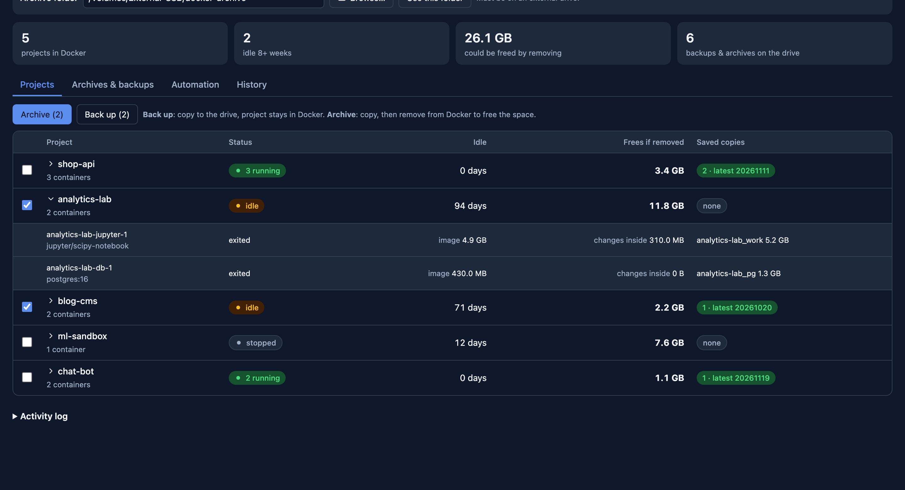
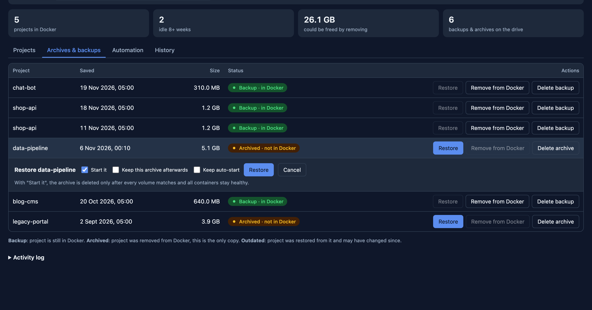
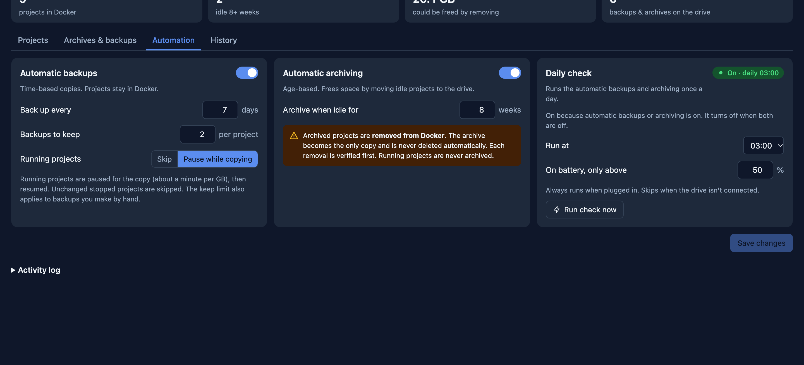
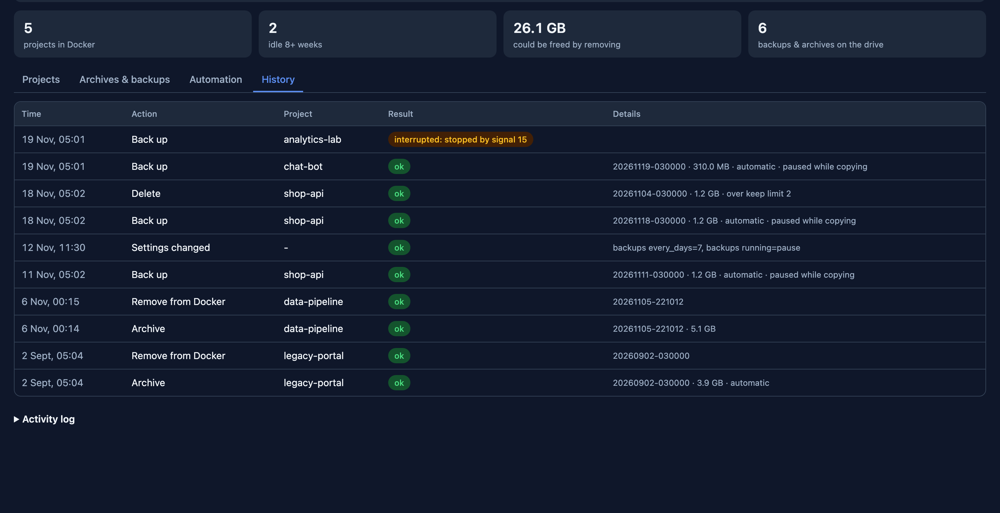
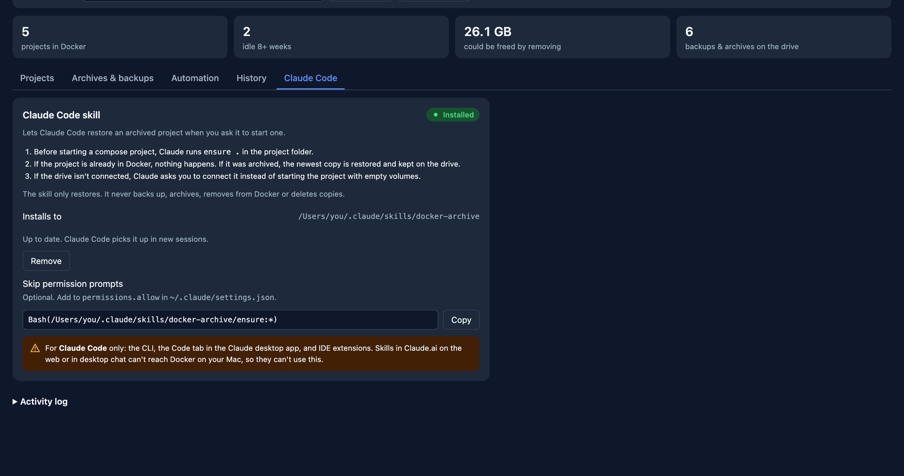

# docker-archive

Free up disk space on your Mac by moving idle Docker Compose projects to an external drive, and bring them back exactly as they were.

Docker Desktop keeps everything in one growing disk file. Projects you haven't touched in months still hold their images, volumes and container state. `docker-archive` copies a whole project (images, volumes, container config, changed files inside containers, compose files and `.env`) to an external drive, checks the copy, and only then removes it from Docker. Restoring re-creates the containers with the same names, networks, volumes and settings.

It comes as a single Python script (stdlib only) and an optional Docker Desktop extension with a UI.

| Projects | Archives & backups |
|---|---|
|  |  |
| **Automation** | **History** |
|  |  |

<sub>Screenshots use demo data.</sub>

> **Status:** early and built for personal use on macOS. It is careful about your data (see Safety), but test it on a project you can afford to lose before trusting it with one you can't. Use at your own risk.

## Backup vs archive

| | Backup | Archive |
|---|---|---|
| What it does | Copies the project to the drive | Copies, verifies, then removes the project from Docker |
| Project afterwards | Stays in Docker | Gone from Docker, the archive is the only copy |
| Frees space | No | Yes |
| Automatic | Every N days (time-based) | When idle for X weeks (age-based) |
| Trimmed by "keep last N" | Yes | Never |

## Requirements

- macOS with Docker Desktop
- Python 3.9+ (the system `/usr/bin/python3` works)
- An external drive mounted under `/Volumes` (the tool refuses to write to the Mac's internal disk)

## Command line

```bash
./docker-archive.py status                       # projects, idle time, size, what removing would free
./docker-archive.py backup myproject --yes       # back up (copy only)
./docker-archive.py backup myproject --pause-running --yes   # back up a running project, paused while copying
./docker-archive.py backup myproject --remove-after --yes    # archive: copy, verify, remove from Docker
./docker-archive.py archives                     # list copies on the drive
./docker-archive.py verify  <archive dir>        # re-check checksums
./docker-archive.py remove  <archive dir> --yes  # remove a backed-up project from Docker
./docker-archive.py restore <archive dir> --start --yes      # restore; deletes the archive once healthy
./docker-archive.py restore <archive dir> --start --keep-backup --yes
./docker-archive.py delete-backup <archive dir> --yes
./docker-archive.py history                      # every action, including failed and interrupted ones
./docker-archive.py ensure .                     # restore the project in this folder if it is not in Docker
./docker-archive.py add-images <archive dir> myapp-base:latest --remove --yes   # add a leftover image to an archive
```

Without `--yes`, commands show their plan and change nothing.

Default drive folder: `/Volumes/External-SSD/docker-archive`. Change it with `--dest PATH` or the `DOCKER_ARCHIVE_DEST` environment variable.

### Automation

```bash
./docker-archive.py settings --backup-enable --backup-days 7 --backup-running pause --max-backups 3
./docker-archive.py settings --archive-enable --archive-weeks 8 --min-battery 50
./docker-archive.py schedule --hour 3            # install the daily check (launchd)
./docker-archive.py auto                         # run the daily check now
```

The daily check runs only when the drive is connected, and on battery only above the set percentage (always when plugged in). Running projects are never archived. For backups they are either skipped or paused for the copy, then resumed.

## Docker Desktop extension

A tab in Docker Desktop with projects, archives and backups, automation settings, history, the Claude Code skill and a live log.

1. Docker Desktop → Settings → Extensions → untick **"Allow only extensions distributed through the Docker Marketplace"** → Apply. (Needed for locally built extensions.)
2. `cd docker-archive-extension && ./build.sh`
3. Open the **Archive** tab in the Docker Desktop sidebar.

Updating the extension stops any job that is running in it, so `build.sh` refuses while one runs.

## Claude Code skill

A Claude Code agent can restore an archived project as part of starting it. Install the skill from the **Claude Code** tab in the extension, or:

```bash
./docker-archive.py install-skill --yes          # installs to ~/.claude/skills/docker-archive
./docker-archive.py install-skill --remove --yes
```

Then, when you ask Claude Code to start a project, it first runs `ensure .` in the project folder:

- project in Docker, or never archived: nothing happens;
- project archived: it is restored (the copy stays on the drive), then Claude starts it as usual;
- drive not connected and the project is archived: Claude asks you to connect it, instead of starting the project with new empty volumes;
- anything unclear (volumes created again after archiving, a moved folder, missing bind-mount folders, a copy that was restored before): Claude stops and asks you.



The skill only restores. It never backs up, archives, removes or deletes. It installs its own copy of the script plus a small `ensure` wrapper, so the agent can run nothing else through it. To skip the permission prompt, add the rule shown in the tab (`Bash(<your home>/.claude/skills/docker-archive/ensure:*)`) to `permissions.allow` in `~/.claude/settings.json`. Re-install after updating the extension; the tab shows "Update available" when needed. Changing the archive folder in the extension updates the skill by itself.

So that `ensure` can tell whether a project is archived while the drive is unplugged, the tool keeps a small list of archived projects in `~/.docker-archive-index.json`, refreshed whenever the drive is connected.

This works with Claude Code only (the CLI, the Code tab in the Claude desktop app, and IDE extensions). Skills in Claude.ai on the web or in desktop chat can't reach Docker on your Mac.

`ensure` also works on its own, for scripts:

```bash
./docker-archive.py ensure .                    # or a compose project name; add --start to start it too
```

| Exit | Meaning |
|---|---|
| 0 | Ready: in Docker, restored, or nothing archived. Start it as usual |
| 3 | The project is (or may be) archived, and the drive is not connected |
| 4 | Needs a decision, or the restore failed. The `ENSURE:` line says why |
| other | Error: 1 general (e.g. Docker not running), 2 bad arguments, 130 interrupted |

### Base images and leftover images

An archive takes the images the project's containers run, and the images those were built on (found by matching image layers), at almost no extra size. When the project is removed from Docker, a base image is removed too, unless a container uses it or another image is still built on it.

Images that no container runs and that nothing in the project is built on, such as build tools or a newer rebuild, are not picked up. Add them to an existing archive with `add-images`. It saves them, re-verifies the whole archive (and puts it back as it was if anything fails), then with `--remove` removes them from Docker. Restoring the archive brings them back, without overwriting newer images of the same name.

## What's in an archive

Each copy is a folder `<drive>/docker-archive/<project>/<timestamp>/` with:

- `images.tar`: all images the containers use, plus the images those were built on (`FROM ...`)
- `extra-images-N.tar` (optional): images added later with `add-images`
- `volumes/*.tgz`: every named and anonymous volume
- `manifest.json`: the full container config
- snapshots of containers with changed files inside them
- `compose/`: copies of the compose files and `.env`
- `checksums.sha256` and a `README.txt` explaining the folder

Bind-mounted folders (files in your repos) are not copied. They stay where they are.

## Safety

- It only writes to a mounted external drive, never the internal disk.
- A backup never removes anything.
- Remove re-verifies the archive first, and refuses when any of these hold:
  - a volume changed since the copy;
  - a container was started or re-created since;
  - files inside a container changed;
  - the copy was taken while the project was running;
  - the archive was restored already.
- Images and volumes that other containers still use are kept.
- A restore that fails partway rolls back what it created.
- After `restore --start`, the archive is deleted only if every volume matches the archive file for file and all containers stay running and healthy for 30 seconds.
- Restored containers do not auto-start with Docker unless you pass `--keep-restart-policy`.
- If a run is stopped, it unpauses anything it paused. A hard kill is cleaned up on the next run.

See [ROADMAP.md](ROADMAP.md) for known gaps.

## License

MIT
